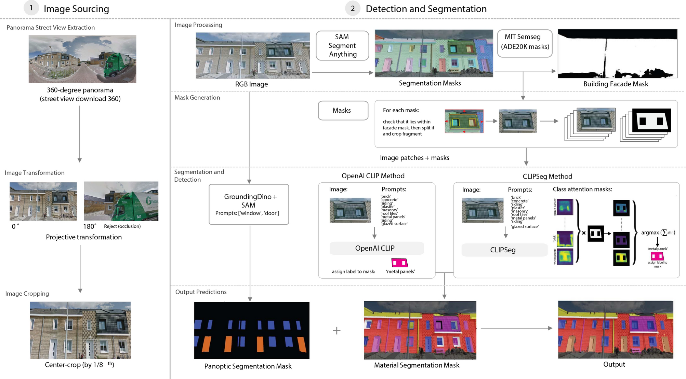
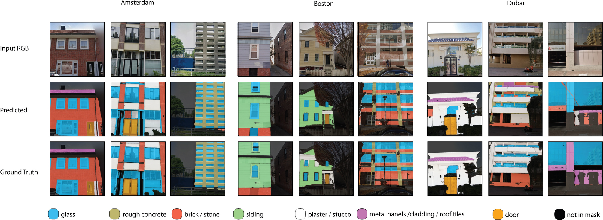
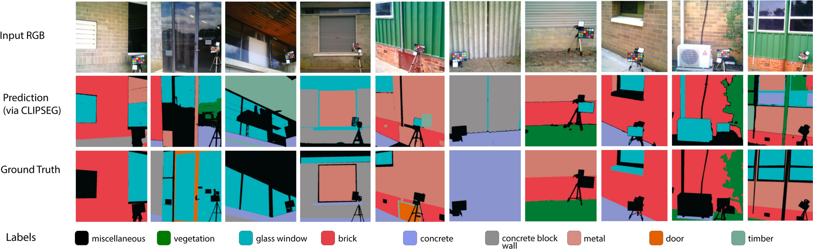
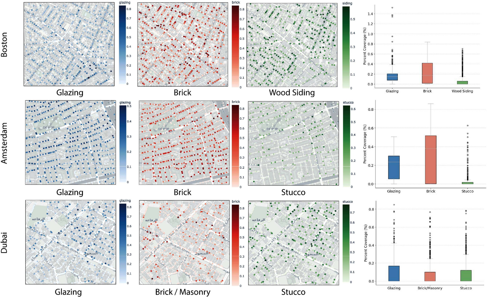
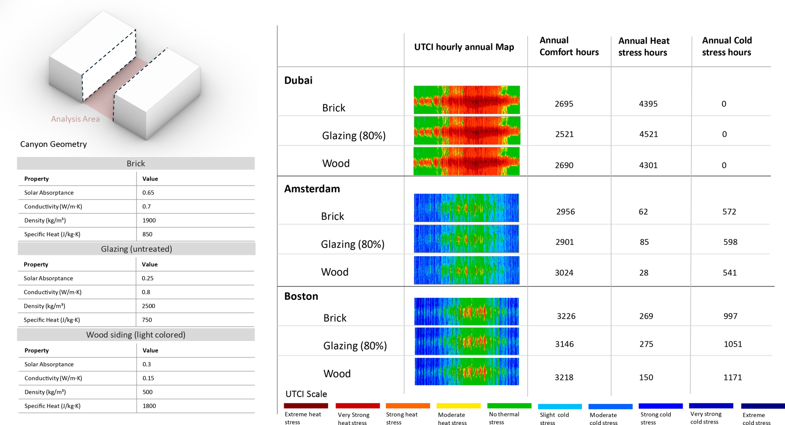

# Zero-Shot Facade Material Segmentation

Code and data for **"Mapping facade materials utilizing zero-shot segmentation for applications in urban microclimate research"**
N. Tarkhan\*, M. Klimenka\*, K. Fang, F. Duarte, C. Ratti, C. Reinhart. *Scientific Reports* 15, 5492 (2025).
[doi.org/10.1038/s41598-025-86307-1](https://doi.org/10.1038/s41598-025-86307-1) · \*equal contribution

This workflow combines zero-shot foundation models (SAM, OpenAI CLIP, CLIPSeg, Grounding DINO) to segment building facade materials from street-view images, **without training on labelled facade data**. It was tested in Boston, Amsterdam and Dubai, three cities with very different architecture:

- the **predominant facade material** is detected correctly in **68%** of facades;
- the **top three materials** present are identified in **85%** of facades;
- the full pipeline reaches a weighted IoU of **0.366**, about 30% higher than a SegFormer model trained on the same small dataset (0.281).

The resulting material maps feed urban microclimate studies (urban heat island, mean radiant temperature, outdoor thermal comfort/UTCI).


*Fig. 1. Workflow: image sourcing and transformation (left), then joint detection and segmentation of facade materials (regions) and facade elements (objects).*

---

## Contents

- [Method](#method)
- [Results](#results)
- [Repository structure](#repository-structure)
- [Installation](#installation)
- [Usage](#usage)
- [Dataset](#dataset)
- [Citation](#citation)

## Method

### 1. Image sourcing

- 360° street-view panoramas are downloaded with *Street View Download 360*.
- Each panorama is warped (projective transformation) into frontal facade views at 0° and 180°. Views with heavy occlusion are rejected.
- Each view is center-cropped (by 1/8). Segmentation runs at 1000 × 1000 or 912 × 912 pixels, depending on scene complexity.

### 2. Facade extraction

A semantic segmentation network trained on **ADE20K** ([MIT semseg](https://github.com/CSAILVision/semantic-segmentation-pytorch), ResNet50-dilated + PPM-deepsup) keeps only the building pixels (ADE20K classes *building* and *house*). Streets, sky, vegetation and other non-facade elements are masked out. Images in which buildings cover less than 20% of the frame are skipped.

### 3. Material segmentation (regions)

Facade materials are textures that spread over the facade, not compact objects. So the facade is first split into patches, and each patch is then classified:

1. **SAM** ([Segment Anything](https://github.com/facebookresearch/segment-anything), ViT-H) splits the image into candidate surface segments. Tuned settings: `points_per_side=64`, `pred_iou_thresh=0.75`, `stability_score_thresh=0.75`. Segments are filtered before classification:
   - very small and near-full-image segments are dropped;
   - segments mostly outside the facade mask are dropped;
   - nested segments are split so each pixel belongs to one patch.
2. Each segment is cropped with a **patch factor of 1.3** × its bounding box, giving the classifier some surrounding context, and assigned one material label:
   - **CLIPSeg method (used in the paper):** [CLIPSeg](https://huggingface.co/CIDAS/clipseg-rd64-refined) produces an attention map for every material prompt. The CLIPSeg attention falling *inside the segment mask* is summed, and the material with the highest total wins.
   - **OpenAI CLIP method (alternative):** [OpenCLIP](https://github.com/mlfoundations/open_clip) ViT-B-32 classifies the masked patch directly against the text prompts.

   CLIPSeg was more accurate across the material classes and is the default.

**Material classes and prompts.** Prompt engineering matters: removing it lowers IoU by 8.2%. Several prompts can map to the same class:

| Class ID | Material | Prompts |
|---|---|---|
| 10 | Glazing | `glazing` |
| 11 | Concrete | `exposed concrete` |
| 12 | Brick / stone / masonry | `brick`, `masonry`, `marble` |
| 13 | Siding | `timber siding`, `siding` |
| 16 | Plaster / stucco | `stucco`, `plaster` |
| 17 | Metal panels / cladding / roof tiles | `metal panels`, `metal panels cladding`, `roof tiles` |

### 4. Facade elements (objects)

Some facade surfaces are objects, not textures. For these, **Grounding DINO + SAM** runs with the prompts `window` and `door`:

- Grounding DINO detects a bounding box for each object;
- SAM turns each box into a pixel-accurate mask;
- the masks are overlaid on the material segmentation as a panoptic mask (window → glazing, class 10; door → class 32).

Glazing is therefore detected twice: as objects (individual windows) and as surfaces (fully glazed facades).

### 5. Runtime

Measured on a single NVIDIA RTX 2080 Ti:

| Step | Time per image |
|---|---|
| ADE20K facade extraction | 0.4 ± 0.6 s |
| SAM patch generation | 13.4 ± 1.5 s |
| Patch classification, OpenAI CLIP | 3.9 ± 2.1 s |
| Patch classification, CLIPSeg | 23.8 ± 9.8 s |
| Grounding DINO windows/doors, on CPU | +20.4 ± 0.2 s |

In total this is about 17.6 s per image with OpenAI CLIP and 37.6 s with CLIPSeg, plus Grounding DINO.

### Evaluation metrics

- **Weighted IoU:** per-class IoU, weighted by each class's pixel ratio. A material presence threshold (1% of pixels) keeps tiny false positives from distorting the score. Precision and recall are reported too.
- **Predominant material:** whether the material covering the largest facade area is predicted correctly.
- **Material presence:** the share of the top three ground-truth materials that are detected.

## Results

### Method comparison (Boston, Amsterdam, Dubai; IoU)

| Class | Pipeline + CLIPSeg | Pipeline + OpenAI CLIP | CLIPSeg only | SegFormer (trained) |
|---|---|---|---|---|
| Glass | **0.610** | 0.601 | 0.530 | 0.444 |
| Concrete | **0.165** | 0.121 | 0.043 | 0.074 |
| Brick | **0.479** | 0.436 | 0.379 | 0.437 |
| Siding | **0.448** | 0.196 | 0.100 | 0.274 |
| Plaster | **0.304** | 0.234 | 0.252 | 0.243 |
| Metal | 0.092 | 0.132 | 0.086 | **0.215** |
| Door | 0.463 | 0.463 | – | – |
| **Total (weighted)** | **0.366** | 0.312 | 0.232 | 0.281 |

The SegFormer baseline (`nvidia/mit-b0`) was trained with 5-fold cross-validation on the 144 labelled facades (learning rate 6e-5, batch size 10).

Sensitivity of the CLIPSeg pipeline:

| Change | Effect on IoU |
|---|---|
| Patch factor 1.3 → 2.0 | −9.6% |
| Patch factor 1.3 → 1.0 | smaller drop than for 2.0 |
| No prompt engineering | −8.2% |
| Image resolution reduced to 75% | −14.9% |

### Per city (Pipeline + CLIPSeg)

| Class | Amsterdam IoU / P / R | Boston IoU / P / R | Dubai IoU / P / R |
|---|---|---|---|
| Glass | 0.711 / 0.824 / 0.831 | 0.550 / 0.651 / 0.796 | 0.564 / 0.703 / 0.758 |
| Concrete | 0.157 / 0.253 / 0.231 | 0.080 / 0.200 / 0.100 | 0.015 / 0.140 / 0.097 |
| Brick | 0.578 / 0.629 / 0.807 | 0.450 / 0.552 / 0.591 | 0.092 / 0.138 / 0.245 |
| Siding | – | 0.172 / 0.254 / 0.313 | – |
| Plaster | 0.217 / 0.321 / 0.326 | 0.342 / 0.608 / 0.424 | 0.273 / 0.418 / 0.327 |
| Metal | 0.252 / 0.295 / 0.446 | 0.044 / 0.050 / 0.104 | 0.184 / 0.308 / 0.333 |
| Door | 0.571 / 0.734 / 0.656 | 0.527 / 0.670 / 0.580 | 0.409 / 0.476 / 0.461 |
| **Total (weighted)** | **0.414 / 0.509 / 0.550** | **0.310 / 0.427 / 0.415** | **0.256 / 0.364 / 0.370** |


*Fig. 3. Example segmentations (input, prediction, ground truth) in Amsterdam, Boston and Dubai.*

### Close-range materials (LIB-HSI)

On the LIB-HSI close-range facade dataset (Habili et al., 2023; 393 images), the pipeline reaches a weighted IoU of 0.337. Per-class IoU ranges from 0.724 (vegetation) and 0.587 (brick) down to near zero (timber).


*Fig. 2. Predictions on LIB-HSI against its superclasses.*

### Neighborhood-scale material maps

The pipeline was deployed over about 1 km² in each city: roughly 1,200 images per city, with two views (0° and 180°) at each street-view point. Average facade coverage, in Boston:

- brick about 24%;
- glazing 16%;
- stucco 8%;
- siding 6.7%.

In Dubai, stucco dominates (34%), followed by glazing (16%).


*Fig. 4. Facade coverage of the three most characteristic materials in each city.*

### Application: outdoor thermal comfort (UTCI)

The UTCI was simulated in a north/south-facing street canyon, 5 m wide with buildings 9 m high, using ClimateStudio/EnergyPlus. Three facade materials were compared: brick, 80% glazing, and light wood siding.

- **All three cities:** glazing gives the most heat-stress hours. In Dubai, the hottest climate, that is about 220 more hours per year than wood.
- **Amsterdam:** glazing also gives the most cold-stress hours, and wood the fewest heat- and cold-stress hours.
- **Boston:** wood reduces heat stress, but has about 17.5% (174) more cold-stress hours than brick, because brick has more thermal mass.


*Fig. 5. Effect of facade material on annual UTCI comfort, heat-stress and cold-stress hours.*

## Repository structure

```
run_zero_shot_inference.py      Full zero-shot pipeline (ADE20K + SAM + CLIPSeg/CLIP + Grounding DINO)
groundingdino_utils_windows.py  Grounding DINO + SAM window/door detection (GROUNDING_DINO_OUTPUT)
raw_clipseg_inference.ipynb     Baseline: CLIPSeg applied directly to the whole image ("CLIPSeg only")
validation_workflow.ipynb       Metrics: weighted IoU, precision, recall, predominant material, presence
TRAIN_SEGFORMER/                Supervised SegFormer baseline
  MANAGE_DATA.ipynb             Remaps class IDs and builds the 5 cross-validation folds
  folds.csv                     Fold assignment of each labelled image
  materials.json                SegFormer id2label mapping
  TRAINING.ipynb                Fine-tunes nvidia/mit-b0
  VALIDATION.ipynb              Predicts on the validation fold
DATASETS/{AMSTERDAM,BOSTON,DUBAI}/MASKS/   Ground-truth material masks
docs/figures/                   Figures from the paper
```

## Installation

Tested with Python 3.10 and an NVIDIA GPU. A GPU is recommended; Grounding DINO can run on CPU.

1. Create an environment and install PyTorch for your CUDA version (see [pytorch.org](https://pytorch.org/get-started/locally/)):

   ```bash
   conda create -n facade python=3.10 -y
   ```

   ```bash
   conda activate facade
   ```

2. Install the dependencies:

   ```bash
   pip install -r requirements.txt
   ```

3. Install Grounding DINO separately (it builds against your installed PyTorch):

   ```bash
   pip install --no-build-isolation git+https://github.com/IDEA-Research/GroundingDINO.git
   ```

4. Download the model weights into `ckpt/`:

   ```bash
   mkdir -p ckpt/ade20k-resnet50dilated-ppm_deepsup
   ```

   ```bash
   wget -P ckpt https://dl.fbaipublicfiles.com/segment_anything/sam_vit_h_4b8939.pth
   ```

   ```bash
   wget -P ckpt https://github.com/IDEA-Research/GroundingDINO/releases/download/v0.1.0-alpha/groundingdino_swint_ogc.pth
   ```

   ```bash
   wget -P ckpt/ade20k-resnet50dilated-ppm_deepsup http://sceneparsing.csail.mit.edu/model/pytorch/ade20k-resnet50dilated-ppm_deepsup/encoder_epoch_20.pth
   ```

   ```bash
   wget -P ckpt/ade20k-resnet50dilated-ppm_deepsup http://sceneparsing.csail.mit.edu/model/pytorch/ade20k-resnet50dilated-ppm_deepsup/decoder_epoch_20.pth
   ```

   The CLIPSeg and OpenCLIP weights download automatically from the Hugging Face Hub on first use.

## Usage

Run the pipeline on a folder of facade images:

```bash
python run_zero_shot_inference.py --input-dir path/to/RGB --output-dir path/to/OUTPUTS --cuda 0
```

Options:

| Option | Default | Meaning |
|---|---|---|
| `--classifier {clipseg,clip}` | `clipseg` | Patch classifier: CLIPSeg (paper method) or OpenAI CLIP |
| `--sam-checkpoint` | `ckpt/sam_vit_h_4b8939.pth` | SAM ViT-H weights |
| `--ade-ckpt-dir` | `ckpt/ade20k-resnet50dilated-ppm_deepsup` | ADE20K encoder/decoder weights |

Grounding DINO is configured with environment variables:

| Variable | Default |
|---|---|
| `GDINO_CHECKPOINT` | `ckpt/groundingdino_swint_ogc.pth` |
| `GDINO_CONFIG` | config shipped with the package |
| `GDINO_DEVICE` | `cpu` |
| `GDINO_BOX_THRESHOLD` | 0.35 |
| `GDINO_TEXT_THRESHOLD` | 0.25 |

Outputs, one file per input image, in sub-folders of `--output-dir`:

| Folder | Content |
|---|---|
| `CLIPSEG/*.npy` | Class-ID mask (IDs as in the table above; 32 = door) |
| `COMBINED/*.jpg` | Prediction overlaid on the image |
| `SAM/*.jpg` | SAM segments overlaid on the image |
| `PRED/*.jpg` | Facade (ADE20K) mask |
| `RGB/*.jpg` | Copy of the input |

To change the materials, edit the prompt table `label_df` in `run_zero_shot_inference.py`. Each row maps a text prompt to a class name, colour and class ID. To compute metrics against ground truth, set the paths in `validation_workflow.ipynb`.

## Dataset

`DATASETS/` contains the hand-labelled ground-truth masks used for the cross-city evaluation, annotated with [Segments.ai](https://segments.ai):

- Amsterdam: 42 masks
- Boston: 59 masks
- Dubai: 59 masks

Each mask is a single-channel image whose pixel values are class IDs. Most are 921 × 921 or 1000 × 1000; a few keep their original size.

| ID | Class |
|---|---|
| 0 | Unlabelled / not facade |
| 10 | Glazing |
| 11 | Concrete |
| 12 | Brick / masonry |
| 13 | Siding |
| 16 | Plaster / stucco |
| 17 | Metal |
| 32 | Door |

The masks are stored as JPEG, so compression can leave a few stray values near class boundaries. Map any value outside the class list to its nearest class, or ignore it.

## Citation

If you use this workflow or dataset, please cite:

```bibtex
@article{tarkhan2025facade,
  title   = {Mapping facade materials utilizing zero-shot segmentation for applications in urban microclimate research},
  author  = {Tarkhan, Nada and Klimenka, Mikita and Fang, Kelly and Duarte, Fabio and Ratti, Carlo and Reinhart, Christoph},
  journal = {Scientific Reports},
  volume  = {15},
  pages   = {5492},
  year    = {2025},
  doi     = {10.1038/s41598-025-86307-1}
}
```

Figures are reproduced from the article, published under a [CC BY-NC-ND 4.0](http://creativecommons.org/licenses/by-nc-nd/4.0/) licence. The code is released under the MIT licence (see `LICENSE`).
